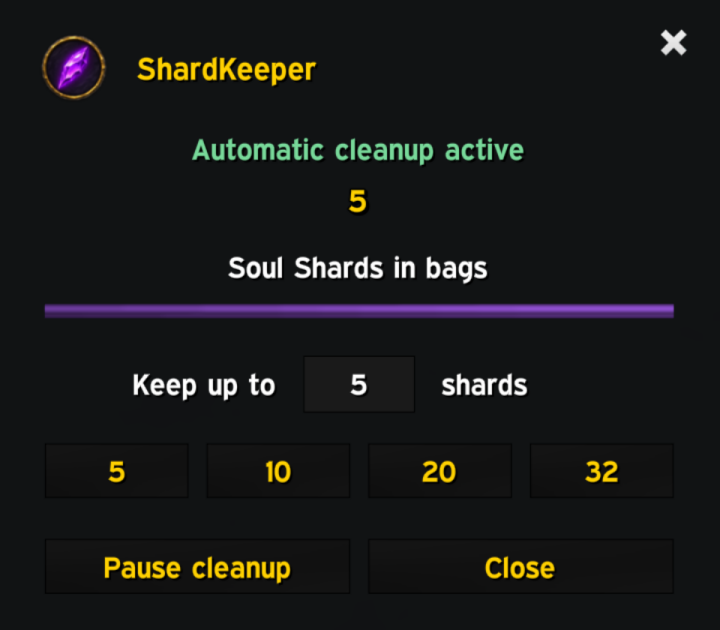
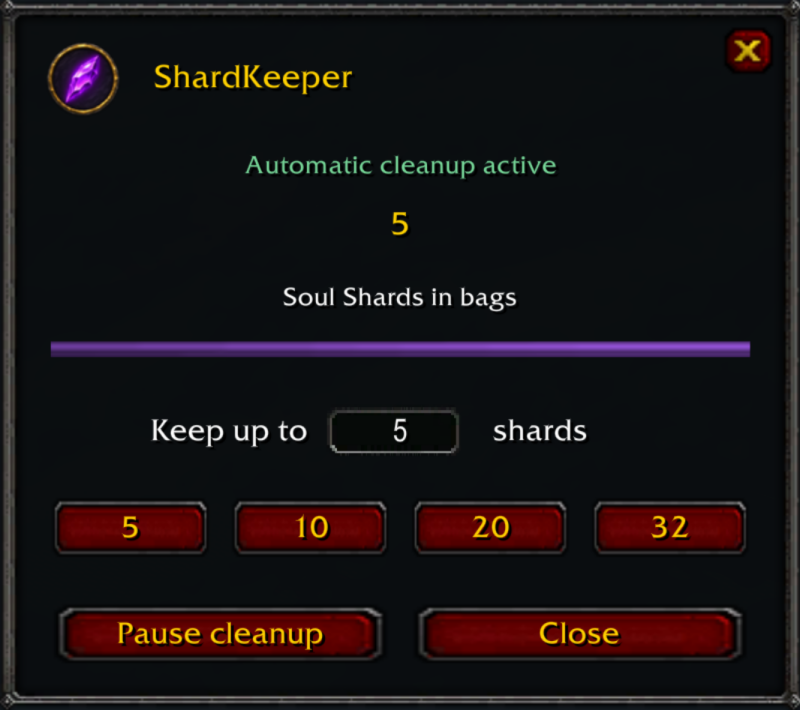

  

# ShardKeeper

Soul Shard management for **Warlocks on WoW 3.3.5a (WotLK)**. Set how many shards you want to keep; ShardKeeper removes the excess from your bags.

[**Download the latest version**](https://github.com/andreash-dev/ShardKeeper-WotLK/releases/latest)

- **Choose a target from 0 to 32**, or use the 5 / 10 / 20 / 32 presets.
- **Pause and resume** without losing your target. Resuming cleans up existing excess.
- **See your shard count** and cleanup status in a compact, movable window.
- **Works with the default WoW UI and ElvUI**, with automatic ElvUI styling.
- **Round and square minimap support**, with distinct active and paused icons.
- **No required dependencies.** Activates only for Warlocks.

## Screenshots

### ElvUI

### Original WoW UI

## Controls

| Action | Control |
| --- | --- |
| Open / close settings | Left-click the minimap icon, `/sk` or `/shardkeeper` |
| Pause / resume cleanup | Right-click the minimap icon or use the panel button |
| Move the minimap icon | Shift + left-drag |
| Save a preset | Click 5, 10, 20 or 32 |
| Save a typed target | Press Enter or close the window with X, Close or Escape |

**Cleanup permanently deletes excess Soul Shards.** A target of 0 removes all carried shards while active. Pause cleanup to keep additional shards.

## Installation

1. Download **ShardKeeper-1.1.0.zip** from [Releases](https://github.com/andreash-dev/ShardKeeper-WotLK/releases/latest).
2. Extract the `ShardKeeper` folder into `World of Warcraft/Interface/AddOns/`.
3. Restart WoW and enable ShardKeeper in the AddOns list.

When updating, replace the existing `ShardKeeper` folder. Your saved settings are retained.

## Compatibility

- **Client:** WoW 3.3.5a, interface 30300. Tested in-game on Warmane.
- **Interface:** standard WoW UI or ElvUI.
- **Settings:** shared across Warlocks on the same account.
- **Shard limit:** WotLK normally allows up to 32 Soul Shards. Choosing a target does not increase the game limit or generate shards.

Cleanup waits for inventory changes to be confirmed before deleting another shard, and skips locked items or an occupied cursor. If inventory updates cannot be confirmed, it stops rather than continuing to delete.

See [CHANGELOG.md](CHANGELOG.md) for release notes. Found a problem? [Open an issue](https://github.com/andreash-dev/ShardKeeper-WotLK/issues) with your client, UI setup and steps to reproduce it.

## Development

Run `lua tests/test_ui.lua` from the repository root. The checks cover settings, UI callbacks, minimap placement and inventory-event regressions; actual rendering and server behavior require in-game testing.

## License

[MIT](LICENSE)
